# Pet Plant — Entity-Relationship (ER) Data Model

> **Architecture Reference & Domain Data Dictionary**
> **Interactive Editorial Diagram:** [View Standalone HTML Diagram](<file:///Users/tinnapatplangsri/Documents/UTS%20semester%203/Industry%20project/codebase/server/docs/er-diagram/er-diagram.html>)
> **Native Draw.io Model:** [`docs/er-diagram/er-diagram.drawio`](<file:///Users/tinnapatplangsri/Documents/UTS%20semester%203/Industry%20project/codebase/server/docs/er-diagram/er-diagram.drawio>)
> **Source Whiteboard Artifact:** [`docs/er-diagram/er-diagram.excalidraw`](<file:///Users/tinnapatplangsri/Documents/UTS%20semester%203/Industry%20project/codebase/server/docs/er-diagram/er-diagram.excalidraw>)

---

## 1. Architectural Invariants & Data Principles

1. **Modular Monolith with Bounded Context Isolation:**Each business domain resides in an isolated package under `src/<context>/` and owns an independent PostgreSQL schema (`auth`, `registry`, `vision`, `knowledge`, `orchestrator`, `assessment`, `advice`, `companion`, `action`).
2. **Zero Cross-Schema Foreign Keys (Strict Rule):**Database-level foreign keys (`REFERENCES ...`) are **strictly forbidden across schema boundaries**. Cross-context relationships are stored as immutable `UUID` attributes and verified through published Python interfaces (`src/<context>/interface.py`).
3. **Aggregate Root & Central Plant Digital Twin:**`registry.plant` is the central aggregate root linking hardware devices, owner accounts, multimodal vision captures, daily VLM assessment probe voting, automated event triggers, and advice care plans.
4. **Single Source of Truth for Care Actions (3NF Normalization):**`advice.care_plan_action` maintains referential grounding to agronomist-approved templates in `knowledge.probe_action` (`approved_action_id`), preventing LLM hallucinations of unverified horticultural treatments.
5. **Idempotent Care Event Ingestion:**
   `action.care_event` enforces a partial unique index on `(plant_id, client_event_id)` where `client_event_id IS NOT NULL` to guarantee zero duplicate actions over unreliable IoT or mobile network conditions.

---

## 2. Interactive Mermaid ER Diagram

```mermaid
%%{init: {
  'theme': 'base',
  'themeVariables': {
    'primaryColor': '#e2e8f0',
    'primaryTextColor': '#0f172a',
    'primaryBorderColor': '#64748b',
    'lineColor': '#475569',
    'secondaryColor': '#f1f5f9',
    'tertiaryColor': '#f8fafc',
    'attributeBackgroundColorOdd': '#f1f5f9',
    'attributeBackgroundColorEven': '#ffffff'
  }
}}%%
erDiagram
    %% ==========================================
    %% AUTH SCHEMA (Identity & Planters)
    %% ==========================================
    "auth.users" {
        UUID id PK
        VARCHAR(320) email UK
        VARCHAR(120) name
        VARCHAR(255) hashed_password
        BOOLEAN is_active
        BOOLEAN is_superuser
        TIMESTAMPTZ created_at
        TIMESTAMPTZ updated_at
    }

    "auth.devices" {
        UUID id PK
        VARCHAR(128) physical_id UK
        UUID owner_id FK "auth.users.id"
        VARCHAR(120) name
        VARCHAR(16) status
        VARCHAR(64) token_hash UK
        TIMESTAMPTZ paired_at
        TIMESTAMPTZ revoked_at
        TIMESTAMPTZ last_seen_at
        TIMESTAMPTZ created_at
    }

    "auth.device_pairings" {
        UUID id PK
        UUID device_id FK "auth.devices.id"
        VARCHAR(128) physical_id "Indexed"
        VARCHAR(16) user_code "Indexed"
        VARCHAR(64) device_code_hash UK
        VARCHAR(16) status
        TIMESTAMPTZ expires_at
        TIMESTAMPTZ created_at
    }

    %% ==========================================
    %% REGISTRY SCHEMA (Plant Digital Twin)
    %% ==========================================
    "registry.plant" {
        UUID id PK "Aggregate Root"
        UUID owner_id "Logical ref: auth.users.id"
        VARCHAR(64) species_code "Logical ref: knowledge.species"
        VARCHAR(128) device_id "Logical ref: auth.devices.physical_id"
        VARCHAR(120) name
        TIMESTAMPTZ species_confirmed_at
        TEXT note
        INTEGER level
        FLOAT xp_ratio
        TIMESTAMPTZ created_at
        TIMESTAMPTZ updated_at
        TIMESTAMPTZ archived_at "Soft delete"
    }

    %% ==========================================
    %% ORCHESTRATOR SCHEMA (Pipeline Execution)
    %% ==========================================
    "orchestrator.pipeline_run" {
        UUID id PK
        UUID plant_id "Logical ref: registry.plant.id"
        TIMESTAMPTZ scheduled_for UK "Composite UK with plant_id"
        VARCHAR(16) trigger
        VARCHAR(16) status
        VARCHAR(32) current_stage
        TEXT detail
        TIMESTAMPTZ created_at
        TIMESTAMPTZ started_at
        TIMESTAMPTZ finished_at
    }

    %% ==========================================
    %% VISION SCHEMA (Multimodal Ingestion)
    %% ==========================================
    "vision.capture" {
        UUID id PK
        UUID plant_id "Logical ref: registry.plant.id"
        UUID run_id "Logical ref: orchestrator.pipeline_run.id"
        VARCHAR(128) device_id
        TIMESTAMPTZ captured_at
        VARCHAR(512) raw_object_key
        INTEGER width
        INTEGER height
        FLOAT brightness
        FLOAT blur_score
        BOOLEAN quality_passed
        VARCHAR(64) quality_reason
        TIMESTAMPTZ created_at
    }

    "vision.processed_frame" {
        UUID id PK
        UUID capture_id FK "vision.capture.id"
        UUID plant_id "Logical ref: registry.plant.id"
        UUID run_id "Logical ref: orchestrator.pipeline_run.id"
        VARCHAR(512) object_key
        VARCHAR(32) crop_type
        INTEGER width
        INTEGER height
        UUID aligned_to_frame_id
        TIMESTAMPTZ processed_at
    }

    %% ==========================================
    %% ASSESSMENT SCHEMA (VLM Probe Voting & Rules)
    %% ==========================================
    "assessment.observation" {
        UUID id PK
        UUID plant_id "Logical ref: registry.plant.id"
        UUID run_id "Logical ref: orchestrator.pipeline_run.id"
        UUID probe_set_id "Logical ref: knowledge.probe_set.id"
        TIMESTAMPTZ timestamp
        VARCHAR(32) health_status
        FLOAT confidence
        JSONB observations_json "Raw VLM runs"
        JSONB consensus_json "Consensus vote result"
        JSONB image_refs_json
        JSONB probe_results_json
        TEXT description
        TEXT companion_message
        TIMESTAMPTZ created_at
    }

    "assessment.trigger_result" {
        UUID id PK
        UUID run_id UK "Logical ref: orchestrator.pipeline_run.id"
        UUID plant_id "Logical ref: registry.plant.id"
        VARCHAR(32) decision "Trigger classification"
        VARCHAR(64) primary_symptom
        FLOAT confidence
        TEXT reasoning
        TIMESTAMPTZ created_at
    }

    "assessment.plant_milestone" {
        UUID id PK
        UUID plant_id "Logical ref: registry.plant.id"
        UUID run_id "Logical ref: orchestrator.pipeline_run.id"
        TIMESTAMPTZ timestamp
        VARCHAR(64) event_type
        TEXT description
        TIMESTAMPTZ resolved_at
        TIMESTAMPTZ created_at
    }

    %% ==========================================
    %% ADVICE SCHEMA (Care Plans & Normalization)
    %% ==========================================
    "advice.care_plan" {
        UUID id PK
        VARCHAR(64) care_plan_id "Indexed"
        UUID plant_id "Logical ref: registry.plant.id"
        UUID run_id UK "Logical ref: orchestrator.pipeline_run.id"
        VARCHAR(64) status_label
        TEXT assessment
        FLOAT confidence
        TIMESTAMPTZ created_at
    }

    "advice.care_plan_action" {
        UUID id PK
        UUID care_plan_pk FK "advice.care_plan.id ON DELETE CASCADE"
        VARCHAR(64) care_plan_id "Indexed"
        VARCHAR(64) action_id
        INTEGER priority
        TEXT action
        TEXT label
        VARCHAR(32) action_type
        UUID approved_action_id "Logical ref: knowledge.probe_action.id"
        VARCHAR(64) check_slug
        VARCHAR(16) urgency
        INTEGER expect_typical_hours
        INTEGER expect_max_hours
        TIMESTAMPTZ created_at
    }

    %% ==========================================
    %% COMPANION SCHEMA (Persona Dialogue)
    %% ==========================================
    "companion.messages" {
        UUID id PK
        UUID plant_id "Logical ref: registry.plant.id"
        UUID run_id "Logical ref: orchestrator.pipeline_run.id"
        VARCHAR(64) decision
        TEXT message
        VARCHAR(32) source
        TIMESTAMPTZ created_at
    }

    %% ==========================================
    %% ACTION SCHEMA (Audited Plant Interventions)
    %% ==========================================
    "action.care_event" {
        UUID id PK
        UUID plant_id "Logical ref: registry.plant.id"
        VARCHAR(128) client_event_id "Partial UK with plant_id where NOT NULL"
        VARCHAR(32) event_type
        VARCHAR(64) care_plan_id "Indexed"
        VARCHAR(64) action_id
        VARCHAR(32) action_type
        JSONB details
        TIMESTAMPTZ occurred_at
        TIMESTAMPTZ recorded_at
        UUID recorded_by_user_id "Logical ref: auth.users.id"
        UUID recorded_by_device_id "Logical ref: auth.devices.id"
    }

    %% ==========================================
    %% KNOWLEDGE SCHEMA (Agronomic Ground Truth)
    %% ==========================================
    "knowledge.species" {
        VARCHAR(64) species_code PK
        VARCHAR(120) scientific_name
        VARCHAR(120) common_name
    }

    "knowledge.research_document" {
        UUID id PK
        VARCHAR(64) species_code FK "knowledge.species.species_code"
        VARCHAR(160) title
        TEXT body
        VARCHAR(64) content_hash "SHA-256 hex of body"
        VARCHAR(120) author
        VARCHAR(512) source_url
        TEXT source_note
        VARCHAR(16) status
        TIMESTAMPTZ created_at
        TIMESTAMPTZ archived_at
    }

    "knowledge.probe_set" {
        UUID id PK
        UUID research_document_id FK "Composite FK with species_code"
        VARCHAR(64) species_code FK "knowledge.species.species_code"
        VARCHAR(64) source_content_hash
        VARCHAR(64) llm_model
        VARCHAR(32) prompt_version
        VARCHAR(16) status
        TIMESTAMPTZ generated_at
        VARCHAR(120) approved_by
        TIMESTAMPTZ approved_at
        VARCHAR(120) rejected_by
        TIMESTAMPTZ rejected_at
        TIMESTAMPTZ archived_at
        TEXT note
        VARCHAR(64) langfuse_trace_id
    }

    "knowledge.probe" {
        UUID id PK
        UUID probe_set_id FK "knowledge.probe_set.id"
        VARCHAR(64) slug UK "Composite UK with probe_set_id"
        VARCHAR(64) care_need
        INTEGER priority
        BOOLEAN is_screening
        TEXT question
        TEXT worse_looks_like
        TEXT better_looks_like
        TEXT not_this
        TEXT evidence_quote
    }

    "knowledge.probe_action" {
        UUID id PK
        UUID probe_id FK "knowledge.probe.id"
        INTEGER ordering
        TEXT instruction
        VARCHAR(16) urgency
        INTEGER expect_typical_hours
        INTEGER expect_max_hours
        VARCHAR(64) expected_signal
    }

    %% ==========================================
    %% RELATIONSHIPS & CARDINALITY
    %% ==========================================

    %% Intra-Schema Database Foreign Keys (enforced by PostgreSQL)
    "auth.users" ||--o{ "auth.devices" : "owns (FK owner_id)"
    "auth.devices" ||--o{ "auth.device_pairings" : "attempts (FK device_id)"
    "vision.capture" ||--o| "vision.processed_frame" : "yields (FK capture_id)"
    "advice.care_plan" ||--|{ "advice.care_plan_action" : "contains (FK care_plan_pk CASCADE)"
    "knowledge.species" ||--o{ "knowledge.research_document" : "cited_in (FK species_code)"
    "knowledge.research_document" ||--o{ "knowledge.probe_set" : "synthesizes (composite FK)"
    "knowledge.species" ||--o{ "knowledge.probe_set" : "calibrates (FK species_code)"
    "knowledge.probe_set" ||--|{ "knowledge.probe" : "defines (FK probe_set_id)"
    "knowledge.probe" ||--|{ "knowledge.probe_action" : "remedies (FK probe_id)"

    %% Cross-Schema Logical References (UUID decoupled, no DB FK)
    "auth.users" ||--o{ "registry.plant" : "owns [ref owner_id]"
    "auth.devices" ||--o| "registry.plant" : "paired_to [ref device_id]"
    "knowledge.species" ||--o{ "registry.plant" : "classifies [ref species_code]"
    "registry.plant" ||--o{ "orchestrator.pipeline_run" : "scheduled_for"
    "registry.plant" ||--o{ "vision.capture" : "ingests_frames"
    "registry.plant" ||--o{ "assessment.observation" : "daily_snapshots"
    "registry.plant" ||--o{ "assessment.plant_milestone" : "records_milestones"
    "registry.plant" ||--o{ "action.care_event" : "care_history"
    "orchestrator.pipeline_run" ||--|| "assessment.trigger_result" : "evaluates (1:1 UK)"
    "orchestrator.pipeline_run" ||--o| "advice.care_plan" : "prescribes (1:0..1 UK)"
    "orchestrator.pipeline_run" ||--o| "companion.messages" : "synthesizes (1:0..1)"
    "advice.care_plan_action" ||--o| "knowledge.probe_action" : "grounded_in [ref approved_action_id]"
    "action.care_event" ||--o| "advice.care_plan_action" : "fulfills_action"
```

---

## 3. Visual Editorial Schematic

> [!TIP]
> Open [docs/er-diagram/er-diagram.html](<file:///Users/tinnapatplangsri/Documents/UTS%20semester%203/Industry%20project/codebase/server/docs/er-diagram/er-diagram.html>) in any browser for full-resolution vector rendering with responsive zooming. Also available in [docs/er-diagram/er-diagram.drawio](<file:///Users/tinnapatplangsri/Documents/UTS%20semester%203/Industry%20project/codebase/server/docs/er-diagram/er-diagram.drawio>) for editable Draw.io workflows.

---

## 4. Data Dictionary by Schema

### 4.1 `auth` Schema — Identity, Authentication & Hardware Devices

| Table                    | Column               | SQL Type         | Constraints                                   | Notes                                                               |
| ------------------------ | -------------------- | ---------------- | --------------------------------------------- | ------------------------------------------------------------------- |
| `auth.users`           | `id`               | `UUID`         | **PK**                                  | Auto-generated `uuid4`.                                           |
|                          | `email`            | `VARCHAR(320)` | **UK**, NOT NULL                        | RFC 5321 max length, indexed.                                       |
|                          | `name`             | `VARCHAR(120)` | NOT NULL                                      | Display name.                                                       |
|                          | `hashed_password`  | `VARCHAR(255)` | NOT NULL                                      | Argon2/bcrypt digest.                                               |
|                          | `is_active`        | `BOOLEAN`      | DEFAULT TRUE, NOT NULL                        | Account state.                                                      |
|                          | `is_superuser`     | `BOOLEAN`      | DEFAULT FALSE, NOT NULL                       | Admin flag.                                                         |
|                          | `created_at`       | `TIMESTAMPTZ`  | NOT NULL                                      | Registration timestamp.                                             |
|                          | `updated_at`       | `TIMESTAMPTZ`  | NOT NULL                                      | Last modification, auto-updated.                                    |
| `auth.devices`         | `id`               | `UUID`         | **PK**                                  | Auto-generated `uuid4`.                                           |
|                          | `physical_id`      | `VARCHAR(128)` | **UK**, NOT NULL                        | Device MAC / serial / provisioning ID.                              |
|                          | `owner_id`         | `UUID`         | **FK** → `auth.users.id`, NOT NULL   | Indexed.                                                            |
|                          | `name`             | `VARCHAR(120)` | NULLABLE                                      | User-assigned planter alias.                                        |
|                          | `status`           | `VARCHAR(16)`  | NOT NULL, DEFAULT `'active'`                | `'active'` \| `'revoked'`.                                      |
|                          | `token_hash`       | `VARCHAR(64)`  | **UK**, NULLABLE                        | SHA-256 of bearer token; NULL during pairing or after revoke.       |
|                          | `paired_at`        | `TIMESTAMPTZ`  | NOT NULL                                      | Initial pairing timestamp.                                          |
|                          | `revoked_at`       | `TIMESTAMPTZ`  | NULLABLE                                      | De-registration timestamp.                                          |
|                          | `last_seen_at`     | `TIMESTAMPTZ`  | NULLABLE                                      | Most recent heartbeat.                                              |
|                          | `created_at`       | `TIMESTAMPTZ`  | NOT NULL                                      | Record creation.                                                    |
| `auth.device_pairings` | `id`               | `UUID`         | **PK**                                  | Ephemeral handshake row.                                            |
|                          | `device_id`        | `UUID`         | **FK** → `auth.devices.id`, NULLABLE | Set once pairing is approved.                                       |
|                          | `physical_id`      | `VARCHAR(128)` | NOT NULL, INDEX                               | Device serial during handshake.                                     |
|                          | `user_code`        | `VARCHAR(16)`  | NOT NULL, INDEX                               | 6-char PIN shown on device screen.                                  |
|                          | `device_code_hash` | `VARCHAR(64)`  | **UK**, NOT NULL                        | SHA-256 of secret device poll token.                                |
|                          | `status`           | `VARCHAR(16)`  | NOT NULL, DEFAULT `'pending'`               | `'pending'` \| `'approved'` \| `'consumed'` \| `'expired'`. |
|                          | `expires_at`       | `TIMESTAMPTZ`  | NOT NULL                                      | Expiry (≈15 min from creation).                                    |
|                          | `created_at`       | `TIMESTAMPTZ`  | NOT NULL                                      | Handshake initiation.                                               |

---

### 4.2 `registry` Schema — Plant Digital Twin (Aggregate Root)

| Table              | Column                   | SQL Type         | Constraints           | Notes                                                                                                                                             |
| ------------------ | ------------------------ | ---------------- | --------------------- | ------------------------------------------------------------------------------------------------------------------------------------------------- |
| `registry.plant` | `id`                   | `UUID`         | **PK**          | Central aggregate root entity ID.                                                                                                                 |
|                    | `owner_id`             | `UUID`         | NOT NULL, INDEX       | Logical ref: `auth.users.id`.                                                                                                                   |
|                    | `name`                 | `VARCHAR(120)` | NOT NULL              | User-assigned plant nickname.                                                                                                                     |
|                    | `species_code`         | `VARCHAR(64)`  | NULLABLE, INDEX       | Logical ref: `knowledge.species.species_code`.                                                                                                  |
|                    | `species_confirmed_at` | `TIMESTAMPTZ`  | NULLABLE              | Locked once owner confirms species.                                                                                                               |
|                    | `device_id`            | `VARCHAR(128)` | NULLABLE              | Logical ref: `auth.devices.physical_id`. Partial UK index: one live plant per device (`WHERE device_id IS NOT NULL AND archived_at IS NULL`). |
|                    | `note`                 | `TEXT`         | NULLABLE              | Free-form owner notes.                                                                                                                            |
|                    | `level`                | `INTEGER`      | NOT NULL, DEFAULT 1   | Gamified companion level.                                                                                                                         |
|                    | `xp_ratio`             | `FLOAT`        | NOT NULL, DEFAULT 0.0 | XP progress within level (0.0–1.0).                                                                                                              |
|                    | `created_at`           | `TIMESTAMPTZ`  | NOT NULL              | Onboarding timestamp.                                                                                                                             |
|                    | `updated_at`           | `TIMESTAMPTZ`  | NOT NULL              | Auto-updated on change.                                                                                                                           |
|                    | `archived_at`          | `TIMESTAMPTZ`  | NULLABLE              | Soft-deletion; history preserved.                                                                                                                 |

---

### 4.3 `orchestrator` Schema — Pipeline Execution

| Table                         | Column            | SQL Type        | Constraints                           | Notes                                                                              |
| ----------------------------- | ----------------- | --------------- | ------------------------------------- | ---------------------------------------------------------------------------------- |
| `orchestrator.pipeline_run` | `id`            | `UUID`        | **PK**                          | Execution ID.                                                                      |
|                               | `plant_id`      | `UUID`        | NOT NULL, INDEX                       | Logical ref: `registry.plant.id`.                                                |
|                               | `scheduled_for` | `TIMESTAMPTZ` | NOT NULL                              | Target slot. Composite UK with `plant_id`.                                       |
|                               | `trigger`       | `VARCHAR(16)` | NOT NULL, DEFAULT `'schedule'`      | `'schedule'` \| `'manual'`.                                                    |
|                               | `status`        | `VARCHAR(16)` | NOT NULL, DEFAULT `'queued'`, INDEX | `'queued'` \| `'running'` \| `'succeeded'` \| `'skipped'` \| `'failed'`. |
|                               | `current_stage` | `VARCHAR(32)` | NOT NULL                              | Active stage (`capture`, `assessment`, `advice`, `companion`).             |
|                               | `detail`        | `TEXT`        | NULLABLE                              | Error message or skip reason.                                                      |
|                               | `created_at`    | `TIMESTAMPTZ` | NOT NULL                              | Run creation timestamp.                                                            |
|                               | `started_at`    | `TIMESTAMPTZ` | NULLABLE                              | Actual start time.                                                                 |
|                               | `finished_at`   | `TIMESTAMPTZ` | NULLABLE                              | Completion time.                                                                   |

---

### 4.4 `vision` Schema — Multimodal Image Ingestion

| Table                      | Column                  | SQL Type         | Constraints                                                       | Notes                                                                              |
| -------------------------- | ----------------------- | ---------------- | ----------------------------------------------------------------- | ---------------------------------------------------------------------------------- |
| `vision.capture`         | `id`                  | `UUID`         | **PK**                                                      | Raw photo payload.                                                                 |
|                            | `plant_id`            | `UUID`         | NOT NULL                                                          | Logical ref: `registry.plant.id`. Composite index: `(plant_id, captured_at)`.  |
|                            | `run_id`              | `UUID`         | NULLABLE                                                          | Logical ref: `orchestrator.pipeline_run.id`; NULL until stage claims.            |
|                            | `device_id`           | `VARCHAR(128)` | NOT NULL                                                          | Ingesting planter serial.                                                          |
|                            | `captured_at`         | `TIMESTAMPTZ`  | NOT NULL                                                          | Device shutter timestamp.                                                          |
|                            | `raw_object_key`      | `VARCHAR(512)` | NOT NULL                                                          | S3/MinIO object key.                                                               |
|                            | `width`               | `INTEGER`      | NOT NULL                                                          | Raw image pixel width.                                                             |
|                            | `height`              | `INTEGER`      | NOT NULL                                                          | Raw image pixel height.                                                            |
|                            | `brightness`          | `FLOAT`        | NULLABLE                                                          | Exposure metric (0.0–1.0).                                                        |
|                            | `blur_score`          | `FLOAT`        | NULLABLE                                                          | Laplacian variance sharpness score.                                                |
|                            | `quality_passed`      | `BOOLEAN`      | NOT NULL                                                          | Pre-processing quality gate verdict.                                               |
|                            | `quality_reason`      | `VARCHAR(64)`  | NULLABLE                                                          | Rejection reason (`too_dark`, `blurry`).                                       |
|                            | `created_at`          | `TIMESTAMPTZ`  | NOT NULL                                                          | Server ingestion timestamp.                                                        |
| `vision.processed_frame` | `id`                  | `UUID`         | **PK**                                                      | Standardized ML-ready crop.                                                        |
|                            | `capture_id`          | `UUID`         | **FK** → `vision.capture.id` ON DELETE CASCADE, NOT NULL |                                                                                    |
|                            | `plant_id`            | `UUID`         | NOT NULL                                                          | Logical ref: `registry.plant.id`. Composite index: `(plant_id, processed_at)`. |
|                            | `run_id`              | `UUID`         | NULLABLE                                                          | Logical ref: `orchestrator.pipeline_run.id`.                                     |
|                            | `object_key`          | `VARCHAR(512)` | NOT NULL                                                          | Processed crop S3 key.                                                             |
|                            | `crop_type`           | `VARCHAR(32)`  | NULLABLE                                                          | `'foliage_square'`, `'canopy_focus'`.                                          |
|                            | `width`               | `INTEGER`      | NOT NULL                                                          | Standardized width (e.g., 512px).                                                  |
|                            | `height`              | `INTEGER`      | NOT NULL                                                          | Standardized height.                                                               |
|                            | `aligned_to_frame_id` | `UUID`         | NULLABLE                                                          | Reference frame for timelapse delta.                                               |
|                            | `processed_at`        | `TIMESTAMPTZ`  | NOT NULL                                                          | Normalization completion.                                                          |

---

### 4.5 `assessment` Schema — VLM Probe Voting & Event Engine

| Table                          | Column                 | SQL Type        | Constraints                    | Notes                                                                                                         |
| ------------------------------ | ---------------------- | --------------- | ------------------------------ | ------------------------------------------------------------------------------------------------------------- |
| `assessment.observation`     | `id`                 | `UUID`        | **PK**                   | Daily health snapshot.                                                                                        |
|                                | `plant_id`           | `UUID`        | NOT NULL, INDEX                | Logical ref: `registry.plant.id`. Composite index: `(plant_id, timestamp)`.                               |
|                                | `run_id`             | `UUID`        | NOT NULL                       | Logical ref: `orchestrator.pipeline_run.id`. Indexed.                                                       |
|                                | `probe_set_id`       | `UUID`        | NULLABLE                       | Logical ref: `knowledge.probe_set.id`; NULL if no probes for species.                                       |
|                                | `timestamp`          | `TIMESTAMPTZ` | NOT NULL                       | Effective assessment date.                                                                                    |
|                                | `health_status`      | `VARCHAR(32)` | NOT NULL                       | `'healthy'` \| `'needs_attention'` \| `'critical'`.                                                     |
|                                | `confidence`         | `FLOAT`       | NOT NULL                       | Aggregate confidence (0.0–1.0).                                                                              |
|                                | `observations_json`  | `JSONB`       | NOT NULL                       | Array of raw per-run VLM probe inferences.                                                                    |
|                                | `consensus_json`     | `JSONB`       | NULLABLE                       | Majority-voting consensus result.                                                                             |
|                                | `image_refs_json`    | `JSONB`       | NULLABLE                       | Frame IDs used in inference.                                                                                  |
|                                | `probe_results_json` | `JSONB`       | NULLABLE                       | Per-probe structured findings (slug, answer, fired, agreement).                                               |
|                                | `description`        | `TEXT`        | NULLABLE                       | Human-readable assessment narrative.                                                                          |
|                                | `companion_message`  | `TEXT`        | NULLABLE                       | Plant companion voice summary.                                                                                |
|                                | `created_at`         | `TIMESTAMPTZ` | NOT NULL                       | Snapshot creation.                                                                                            |
| `assessment.trigger_result`  | `id`                 | `UUID`        | **PK**                   | 0-token Event Engine verdict.                                                                                 |
|                                | `run_id`             | `UUID`        | NOT NULL, **UK** (index) | Logical ref: `orchestrator.pipeline_run.id`; exactly 1 verdict per run.                                     |
|                                | `plant_id`           | `UUID`        | NOT NULL, INDEX                | Logical ref: `registry.plant.id`.                                                                           |
|                                | `decision`           | `VARCHAR(32)` | NOT NULL                       | `'CARE_ADVICE_REQUIRED'` \| `'NO_ACTION'` \| `'REQUEST_MORE_INFORMATION'`.                              |
|                                | `primary_symptom`    | `VARCHAR(64)` | NULLABLE                       | Dominant trigger symptom.                                                                                     |
|                                | `confidence`         | `FLOAT`       | NOT NULL, DEFAULT 1.0          | Rule-engine confidence.                                                                                       |
|                                | `reasoning`          | `TEXT`        | NULLABLE                       | Decision justification.                                                                                       |
|                                | `created_at`         | `TIMESTAMPTZ` | NOT NULL                       | Evaluation timestamp.                                                                                         |
| `assessment.plant_milestone` | `id`                 | `UUID`        | **PK**                   | Lifecycle event log.                                                                                          |
|                                | `plant_id`           | `UUID`        | NOT NULL, INDEX                | Logical ref: `registry.plant.id`. Composite indexes: `(plant_id, timestamp)`, `(plant_id, event_type)`. |
|                                | `run_id`             | `UUID`        | NULLABLE                       | Logical ref: `orchestrator.pipeline_run.id`.                                                                |
|                                | `timestamp`          | `TIMESTAMPTZ` | NOT NULL                       | Detection timestamp.                                                                                          |
|                                | `event_type`         | `VARCHAR(64)` | NOT NULL                       | E.g. `'new_leaf'`, `'flowering'`, `'recovery'`.                                                         |
|                                | `description`        | `TEXT`        | NOT NULL                       | Celebratory milestone narrative.                                                                              |
|                                | `resolved_at`        | `TIMESTAMPTZ` | NULLABLE                       | Resolved timestamp for condition-based milestones.                                                            |
|                                | `created_at`         | `TIMESTAMPTZ` | NOT NULL                       | Log timestamp.                                                                                                |

---

### 4.6 `advice` Schema — Care Plans & 3NF Normalized Actions

| Table                       | Column                   | SQL Type         | Constraints                                                         | Notes                                                                 |
| --------------------------- | ------------------------ | ---------------- | ------------------------------------------------------------------- | --------------------------------------------------------------------- |
| `advice.care_plan`        | `id`                   | `UUID`         | **PK**                                                        | Holistic care prescription.                                           |
|                             | `care_plan_id`         | `VARCHAR(64)`  | NOT NULL, INDEX                                                     | Domain plan code (e.g. `cp_20261018_xyz`).                          |
|                             | `plant_id`             | `UUID`         | NOT NULL, INDEX                                                     | Logical ref: `registry.plant.id`.                                   |
|                             | `run_id`               | `UUID`         | NOT NULL, **UK** (index)                                      | Logical ref: `orchestrator.pipeline_run.id`; 1 plan per run.        |
|                             | `status_label`         | `VARCHAR(64)`  | NOT NULL                                                            | `'optimal'` \| `'mild_stress'` \| `'urgent_intervention'`.      |
|                             | `assessment`           | `TEXT`         | NOT NULL                                                            | LLM diagnostic summary.                                               |
|                             | `confidence`           | `FLOAT`        | NOT NULL                                                            | Advisor confidence score.                                             |
|                             | `created_at`           | `TIMESTAMPTZ`  | NOT NULL                                                            | Plan generation timestamp.                                            |
| `advice.care_plan_action` | `id`                   | `UUID`         | **PK**                                                        | Atomic normalized action step.                                        |
|                             | `care_plan_pk`         | `UUID`         | **FK** → `advice.care_plan.id` ON DELETE CASCADE, NOT NULL | Indexed.                                                              |
|                             | `care_plan_id`         | `VARCHAR(64)`  | NOT NULL, INDEX                                                     | Denormalized plan domain code.                                        |
|                             | `action_id`            | `VARCHAR(64)`  | NOT NULL                                                            | Action slug (`water_soil_50ml`).                                    |
|                             | `priority`             | `INTEGER`      | NOT NULL, DEFAULT 1                                                 | Execution ordering.                                                   |
|                             | `action`               | `TEXT`         | NOT NULL                                                            | Imperative instruction verb.                                          |
|                             | `label`                | `VARCHAR(120)` | NOT NULL                                                            | UI display label.                                                     |
|                             | `action_type`          | `VARCHAR(32)`  | NOT NULL, DEFAULT `'other'`                                       | `'water'` \| `'move'` \| `'inspect'` \| `'other'`.            |
|                             | `approved_action_id`   | `UUID`         | NULLABLE                                                            | Logical ref: `knowledge.probe_action.id` (**3NF grounding**). |
|                             | `check_slug`           | `VARCHAR(64)`  | NULLABLE                                                            | Relevant probe slug.                                                  |
|                             | `urgency`              | `VARCHAR(16)`  | NULLABLE                                                            | `'immediate'` \| `'today'` \| `'routine'`.                      |
|                             | `expect_typical_hours` | `INTEGER`      | NULLABLE                                                            | Expected response window hours.                                       |
|                             | `expect_max_hours`     | `INTEGER`      | NULLABLE                                                            | Maximum observation grace period.                                     |
|                             | `created_at`           | `TIMESTAMPTZ`  | NOT NULL                                                            | Record timestamp.                                                     |

---

### 4.7 `companion` Schema — Persona Dialogue

| Table                  | Column         | SQL Type        | Constraints     | Notes                                          |
| ---------------------- | -------------- | --------------- | --------------- | ---------------------------------------------- |
| `companion.messages` | `id`         | `UUID`        | **PK**    | Companion dialogue record.                     |
|                        | `plant_id`   | `UUID`        | NOT NULL, INDEX | Logical ref: `registry.plant.id`.            |
|                        | `run_id`     | `UUID`        | NOT NULL, INDEX | Logical ref: `orchestrator.pipeline_run.id`. |
|                        | `decision`   | `VARCHAR(64)` | NOT NULL        | Conversational intent/mood token.              |
|                        | `message`    | `TEXT`        | NOT NULL        | First-person plant persona dialogue.           |
|                        | `source`     | `VARCHAR(32)` | NOT NULL        | `'llm_prompt'` \| `'fallback'`.            |
|                        | `created_at` | `TIMESTAMPTZ` | NOT NULL        | Generation timestamp.                          |

---

### 4.8 `action` Schema — Audited Plant Interventions

| Table                 | Column                    | SQL Type         | Constraints     | Notes                                                                                                                                       |
| --------------------- | ------------------------- | ---------------- | --------------- | ------------------------------------------------------------------------------------------------------------------------------------------- |
| `action.care_event` | `id`                    | `UUID`         | **PK**    | Append-only audit log row.                                                                                                                  |
|                       | `plant_id`              | `UUID`         | NOT NULL        | Logical ref: `registry.plant.id`. Composite indexes: `(plant_id, client_event_id)` partial UK, `(plant_id, event_type, occurred_at)`. |
|                       | `event_type`            | `VARCHAR(32)`  | NOT NULL        | `'action_completed'` \| `'watered'`.                                                                                                    |
|                       | `care_plan_id`          | `VARCHAR(64)`  | NULLABLE, INDEX | Associated plan code if fulfilling advice.                                                                                                  |
|                       | `action_id`             | `VARCHAR(64)`  | NULLABLE        | Associated action item.                                                                                                                     |
|                       | `action_type`           | `VARCHAR(32)`  | NULLABLE        | `'water'` \| `'move'` \| `'inspect'` \| `'other'`.                                                                                  |
|                       | `details`               | `JSONB`        | NULLABLE        | Event-specific extras (`{"volume_ml": 100}`).                                                                                             |
|                       | `occurred_at`           | `TIMESTAMPTZ`  | NOT NULL        | Client-reported action timestamp.                                                                                                           |
|                       | `recorded_at`           | `TIMESTAMPTZ`  | NOT NULL        | Server ingestion timestamp.                                                                                                                 |
|                       | `recorded_by_user_id`   | `UUID`         | NULLABLE        | Logical ref: `auth.users.id`.                                                                                                             |
|                       | `recorded_by_device_id` | `UUID`         | NULLABLE        | Logical ref: `auth.devices.id`.                                                                                                           |
|                       | `client_event_id`       | `VARCHAR(128)` | NULLABLE        | **Partial UK**: `(plant_id, client_event_id) WHERE client_event_id IS NOT NULL`.                                                    |

---

### 4.9 `knowledge` Schema — Agronomic Ground Truth

| Table                           | Column                   | SQL Type         | Constraints                                                  | Notes                                                                                              |
| ------------------------------- | ------------------------ | ---------------- | ------------------------------------------------------------ | -------------------------------------------------------------------------------------------------- |
| `knowledge.species`           | `species_code`         | `VARCHAR(64)`  | **PK**                                                 | Taxonomic slug (e.g. `monstera_deliciosa`).                                                      |
|                                 | `scientific_name`      | `VARCHAR(120)` | NOT NULL                                                     | Binomial nomenclature.                                                                             |
|                                 | `common_name`          | `VARCHAR(120)` | NULLABLE                                                     | Common English name.                                                                               |
| `knowledge.research_document` | `id`                   | `UUID`         | **PK**                                                 | Agronomic reference paper.                                                                         |
|                                 | `species_code`         | `VARCHAR(64)`  | **FK** → `knowledge.species.species_code`, NOT NULL | Composite UK: `(id, species_code)`. Partial UK: one active per species.                          |
|                                 | `title`                | `VARCHAR(160)` | NOT NULL                                                     | Document title.                                                                                    |
|                                 | `body`                 | `TEXT`         | NOT NULL                                                     | Research text fed to LLM.                                                                          |
|                                 | `content_hash`         | `VARCHAR(64)`  | NOT NULL                                                     | SHA-256 hex digest of `body`.                                                                    |
|                                 | `author`               | `VARCHAR(120)` | NOT NULL                                                     | Researcher or institution.                                                                         |
|                                 | `source_url`           | `VARCHAR(512)` | NULLABLE                                                     | Authoritative URL.                                                                                 |
|                                 | `source_note`          | `TEXT`         | NULLABLE                                                     | Editorial or licensing notes.                                                                      |
|                                 | `status`               | `VARCHAR(16)`  | NOT NULL, DEFAULT `'active'`                               | `'active'` \| `'archived'`.                                                                    |
|                                 | `created_at`           | `TIMESTAMPTZ`  | NOT NULL                                                     | Ingestion timestamp.                                                                               |
|                                 | `archived_at`          | `TIMESTAMPTZ`  | NULLABLE                                                     | Deprecation timestamp.                                                                             |
| `knowledge.probe_set`         | `id`                   | `UUID`         | **PK**                                                 | Versioned check collection.                                                                        |
|                                 | `research_document_id` | `UUID`         | NOT NULL                                                     | Composite FK: `(research_document_id, species_code)` → `research_document(id, species_code)`. |
|                                 | `species_code`         | `VARCHAR(64)`  | NOT NULL                                                     | Denormalized from document (enforced by composite FK). Partial UK: one approved per species.       |
|                                 | `source_content_hash`  | `VARCHAR(64)`  | NOT NULL                                                     | Document body hash at generation time (drift detection).                                           |
|                                 | `llm_model`            | `VARCHAR(64)`  | NOT NULL                                                     | Model identifier (e.g. `gpt-4o-2024-11-20`).                                                     |
|                                 | `prompt_version`       | `VARCHAR(32)`  | NULLABLE                                                     | Prompt template version.                                                                           |
|                                 | `status`               | `VARCHAR(16)`  | NOT NULL, DEFAULT `'draft'`                                | `'draft'` \| `'approved'` \| `'archived'`.                                                   |
|                                 | `generated_at`         | `TIMESTAMPTZ`  | NOT NULL                                                     | Synthesis timestamp.                                                                               |
|                                 | `approved_by`          | `VARCHAR(120)` | NULLABLE                                                     | Expert who signed off.                                                                             |
|                                 | `approved_at`          | `TIMESTAMPTZ`  | NULLABLE                                                     | Sign-off timestamp.                                                                                |
|                                 | `rejected_by`          | `VARCHAR(120)` | NULLABLE                                                     | Reviewer who rejected.                                                                             |
|                                 | `rejected_at`          | `TIMESTAMPTZ`  | NULLABLE                                                     | Rejection timestamp.                                                                               |
|                                 | `archived_at`          | `TIMESTAMPTZ`  | NULLABLE                                                     | Archival timestamp.                                                                                |
|                                 | `note`                 | `TEXT`         | NULLABLE                                                     | Review notes.                                                                                      |
|                                 | `langfuse_trace_id`    | `VARCHAR(64)`  | NULLABLE                                                     | Observability trace link to generation run.                                                        |
| `knowledge.probe`             | `id`                   | `UUID`         | **PK**                                                 | Atomic visual symptom check.                                                                       |
|                                 | `probe_set_id`         | `UUID`         | **FK** → `knowledge.probe_set.id`, NOT NULL         | Composite UK: `(probe_set_id, slug)`.                                                            |
|                                 | `slug`                 | `VARCHAR(64)`  | NOT NULL                                                     | Diagnostic code (e.g. `water_deficit.leaf_droop`).                                               |
|                                 | `care_need`            | `VARCHAR(64)`  | NOT NULL                                                     | Physiological stress category (e.g. `water_deficit`).                                            |
|                                 | `priority`             | `INTEGER`      | NOT NULL                                                     | Evaluation order.                                                                                  |
|                                 | `is_screening`         | `BOOLEAN`      | NOT NULL, DEFAULT FALSE                                      | Whether included in primary screening pass.                                                        |
|                                 | `question`             | `TEXT`         | NOT NULL                                                     | Binary visual query for VLM.                                                                       |
|                                 | `worse_looks_like`     | `TEXT`         | NOT NULL                                                     | Positive symptom visual anchor description.                                                        |
|                                 | `better_looks_like`    | `TEXT`         | NOT NULL                                                     | Healthy negative anchor description.                                                               |
|                                 | `not_this`             | `TEXT`         | NOT NULL                                                     | False-positive guard description.                                                                  |
|                                 | `evidence_quote`       | `TEXT`         | NULLABLE                                                     | Verbatim source research quote.                                                                    |
| `knowledge.probe_action`      | `id`                   | `UUID`         | **PK**                                                 | Vetted remedial action template.                                                                   |
|                                 | `probe_id`             | `UUID`         | **FK** → `knowledge.probe.id`, NOT NULL             | Cascade-deleted with probe.                                                                        |
|                                 | `ordering`             | `INTEGER`      | NOT NULL, DEFAULT 0                                          | Action execution priority.                                                                         |
|                                 | `instruction`          | `TEXT`         | NOT NULL                                                     | Standard agronomic instruction.                                                                    |
|                                 | `urgency`              | `VARCHAR(16)`  | NOT NULL                                                     | `'today'` \| `'this_week'` \| `'this_month'`.                                                |
|                                 | `expect_typical_hours` | `INTEGER`      | NOT NULL                                                     | Baseline physiological response time.                                                              |
|                                 | `expect_max_hours`     | `INTEGER`      | NOT NULL                                                     | Grace period before re-evaluation.                                                                 |
|                                 | `expected_signal`      | `VARCHAR(64)`  | NULLABLE                                                     | Recovery biomarker (e.g. `'leaf_recovery'`).                                                     |

---

## 5. Referential Enforcement Matrix

| Source Table                    | Column                                   | Target                                                  | Type                         | Enforcement                                              |
| ------------------------------- | ---------------------------------------- | ------------------------------------------------------- | ---------------------------- | -------------------------------------------------------- |
| `auth.devices`                | `owner_id`                             | `auth.users.id`                                       | Intra-schema DB FK           | PostgreSQL constraint, `ON DELETE RESTRICT` (implicit) |
| `auth.device_pairings`        | `device_id`                            | `auth.devices.id`                                     | Intra-schema DB FK           | PostgreSQL constraint                                    |
| `vision.processed_frame`      | `capture_id`                           | `vision.capture.id`                                   | Intra-schema DB FK           | PostgreSQL constraint, `ON DELETE CASCADE`             |
| `advice.care_plan_action`     | `care_plan_pk`                         | `advice.care_plan.id`                                 | Intra-schema DB FK           | PostgreSQL constraint, `ON DELETE CASCADE`             |
| `knowledge.research_document` | `species_code`                         | `knowledge.species.species_code`                      | Intra-schema DB FK           | PostgreSQL constraint                                    |
| `knowledge.probe_set`         | `(research_document_id, species_code)` | `knowledge.research_document.(id, species_code)`      | Composite intra-schema DB FK | Named `fk_probe_set_research_document`                 |
| `knowledge.probe`             | `probe_set_id`                         | `knowledge.probe_set.id`                              | Intra-schema DB FK           | PostgreSQL constraint                                    |
| `knowledge.probe_action`      | `probe_id`                             | `knowledge.probe.id`                                  | Intra-schema DB FK           | PostgreSQL constraint, cascade-deleted                   |
| `registry.plant`              | `owner_id`                             | `auth.users.id`                                       | Cross-schema logical ref     | Service-layer: `auth.interface.get_user()`             |
| `registry.plant`              | `device_id`                            | `auth.devices.physical_id`                            | Cross-schema logical ref     | Service-layer: `auth.interface.verify_device()`        |
| `registry.plant`              | `species_code`                         | `knowledge.species.species_code`                      | Cross-schema logical ref     | Service-layer: `knowledge.interface.get_species()`     |
| `orchestrator.pipeline_run`   | `plant_id`                             | `registry.plant.id`                                   | Cross-schema logical ref     | Service-layer validation                                 |
| `vision.capture`              | `plant_id`                             | `registry.plant.id`                                   | Cross-schema logical ref     | Ingestion validation                                     |
| `vision.capture`              | `run_id`                               | `orchestrator.pipeline_run.id`                        | Cross-schema logical ref     | Stage claim                                              |
| `assessment.observation`      | `plant_id`, `run_id`                 | `registry.plant.id`, `orchestrator.pipeline_run.id` | Cross-schema logical ref     | Assessment service                                       |
| `assessment.observation`      | `probe_set_id`                         | `knowledge.probe_set.id`                              | Cross-schema logical ref     | `knowledge.interface.get_approved_checks()`            |
| `assessment.trigger_result`   | `run_id`                               | `orchestrator.pipeline_run.id`                        | Cross-schema logical ref     | Unique index enforces 1:1                                |
| `advice.care_plan`            | `run_id`                               | `orchestrator.pipeline_run.id`                        | Cross-schema logical ref     | Unique index enforces 1:1                                |
| `advice.care_plan_action`     | `approved_action_id`                   | `knowledge.probe_action.id`                           | Cross-schema logical ref     | 3NF grounding check before emission                      |
| `companion.messages`          | `plant_id`, `run_id`                 | `registry.plant.id`, `orchestrator.pipeline_run.id` | Cross-schema logical ref     | Companion service                                        |
| `action.care_event`           | `plant_id`                             | `registry.plant.id`                                   | Cross-schema logical ref     | Action service                                           |
| `action.care_event`           | `client_event_id`                      | *(idempotency key)*                                   | Partial unique index         | `WHERE client_event_id IS NOT NULL`                    |
