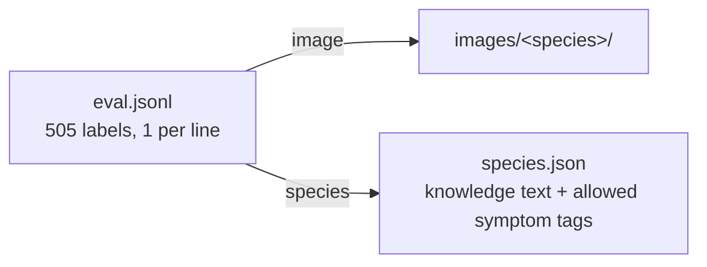
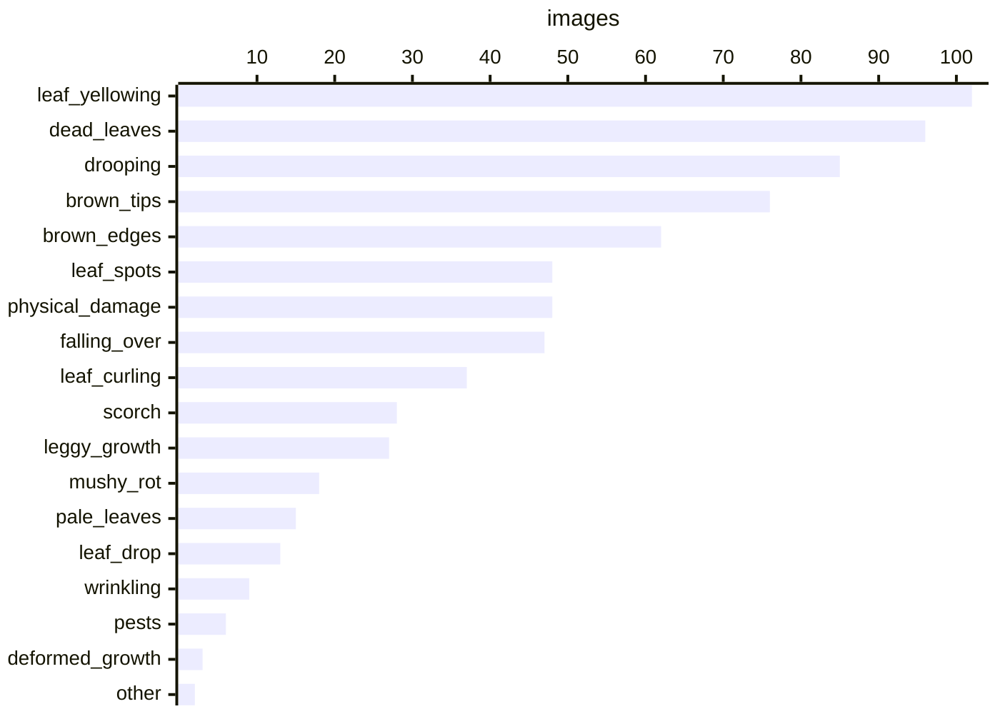
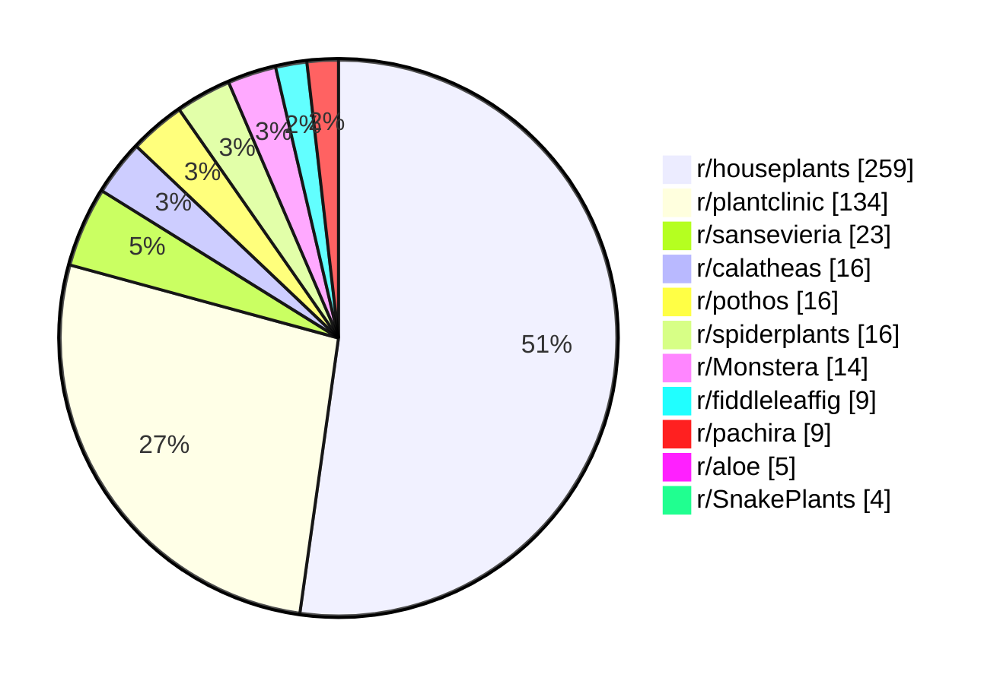

# Houseplant Condition Evaluation Set

505 houseplant photos of 10 species, each labeled `healthy` or `unhealthy` with the visible symptoms. It evaluates **condition assessment**, not species identification: the species is known, and a model gets the image plus a short care-knowledge text for that species (`species.json`) and must judge the plant's condition.

Exported 2026-10-13. Human-reviewed: **505 / 505** images.

## Files



## Species

| Key | Plant | Healthy | Unhealthy |
|---|---|---:|---:|
| `peace_lily` | Peace lily (Spathiphyllum) | 23 | 25 |
| `money_tree` | Money tree (Pachira aquatica) | 26 | 25 |
| `pothos` | Pothos (Epipremnum aureum) | 28 | 27 |
| `snake_plant` | Snake plant (Dracaena trifasciata, syn. Sansevieria) | 26 | 26 |
| `calathea` | Calathea (Goeppertia) | 25 | 25 |
| `monstera` | Monstera (Monstera deliciosa) | 25 | 25 |
| `zz_plant` | ZZ plant (Zamioculcas zamiifolia) | 25 | 25 |
| `fiddle_leaf_fig` | Fiddle leaf fig (Ficus lyrata) | 25 | 25 |
| `spider_plant` | Spider plant (Chlorophytum comosum) | 25 | 25 |
| `aloe_vera` | Aloe vera (Aloe barbadensis miller) | 22 | 27 |

## `eval.jsonl`

| Field | Meaning |
|---|---|
| `id` | `<species>/<image_id>`, unique |
| `species` | Species key in `species.json` |
| `image` | Image path relative to this folder |
| `status` | Ground truth: `healthy` or `unhealthy` |
| `symptoms` | Visible symptom tags (empty when healthy) |
| `note` | Free-text reviewer note (usually empty) |
| `reviewed` | `true` if checked by a human |
| `source` | `reddit` or `manual` (own photo) |
| `post_id`, `permalink`, `image_url` | Original Reddit post and image (`null` for own photos) |
| `sha256` | Image hash, to exclude these images from training data |

```json
{"id": "aloe_vera/1uhdpd7_0", "species": "aloe_vera", "image": "images/aloe_vera/1uhdpd7_0.jpg", "status": "unhealthy", "symptoms": ["scorch"], "note": "", "reviewed": true, "source": "reddit", "post_id": "1uhdpd7", "permalink": "https://www.reddit.com/r/houseplants/comments/1uhdpd7/aloe_help/", "image_url": "https://i.redd.it/jfs4hsqd2w9h1.jpeg", "sha256": "423810e4a4a2ec7e55e224e6ca720463cbc8319a78fa42e2dc0edb4ed038803d"}
```

## `species.json`

```
{"species":  {<key>: {"name", "knowledge", "symptoms": [allowed tags]}},
 "symptoms": {<tag>: description}}
```

`knowledge` is the text meant to be given to the model with each image. It also describes normal features that look like problems (e.g. normal leaf movement or aging).

## Usage

```python
import json

meta = json.load(open("species.json", encoding="utf-8"))
for row in map(json.loads, open("eval.jsonl", encoding="utf-8")):
    knowledge = meta["species"][row["species"]]["knowledge"]
    # model(row["image"], knowledge) -> predict status / symptoms,
    # then compare with row["status"] and row["symptoms"]
```

## Symptom tags

255 unhealthy images, 2.8 tags per image on average. An image can have several tags. Each species only uses the tags listed for it in `species.json`. 2 unhealthy images have no tag (problem not covered by the tags).



| Tag | Description | Images |
|---|---|---:|
| `leaf_yellowing` | Leaves partly or entirely yellow | 102 |
| `dead_leaves` | Entire leaves dead: fully brown, black, dried, or papery | 96 |
| `drooping` | Leaves or stems droop or wilt; the plant looks limp | 85 |
| `brown_tips` | Brown, dry leaf tips | 76 |
| `brown_edges` | Brown, crispy leaf margins | 62 |
| `leaf_spots` | Distinct brown or black spots/lesions on the leaf surface, often with a yellow halo | 48 |
| `physical_damage` | Holes, tears, cuts, or broken leaves/stems | 48 |
| `falling_over` | Leaves or stems flopping, bending, or collapsing outward | 47 |
| `leaf_curling` | Leaves curl, roll, or cup | 37 |
| `scorch` | Bleached, whitish or tan sunburned patches | 28 |
| `leggy_growth` | Stretched stems with sparse or small leaves, leaning toward the light | 27 |
| `mushy_rot` | Soft, mushy, dark tissue on stems, base, trunk, or leaves | 18 |
| `pale_leaves` | Pale, faded, or washed-out leaf color or variegation | 15 |
| `leaf_drop` | Leaves fallen or falling off; sparse foliage | 13 |
| `wrinkling` | Leaves wrinkled, thinned, or shriveled | 9 |
| `pests` | Visible insects, webbing, sticky residue, or stippling damage | 6 |
| `deformed_growth` | Misshapen, stunted, or distorted new leaves | 3 |
| `other` | Other visible abnormality (describe in the note) | 2 |
| `powdery_coating` | White powdery or fuzzy coating on leaves | 0 |

## Sources



Labels were drafted by an LLM (Gemini) from the image, with Reddit post text used only as hints, and every label was then reviewed and corrected by a human. Photos were filtered to show one whole plant whose condition can be judged from the photo alone (no leaf close-ups, detached leaves, distant shots, or several competing plants).

## License and use

Images are from public Reddit posts and remain the property of their authors; `permalink` gives attribution. Use this set for research evaluation only, and do not train on it (use `sha256` / `post_id` to exclude these images from training data).
